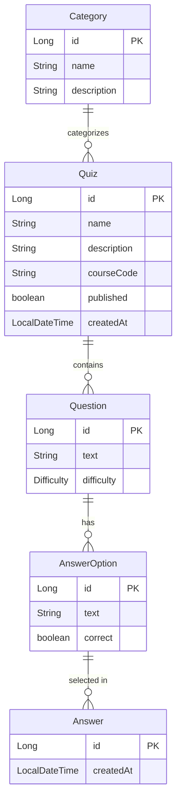

# Quizzer

Quizzer is a web application where teachers can create and manage quizzes, and students can take them to learn about course topics.

This project is developed by team **Hello World**.

## Team members

- Mai Vu ([maivu07](https://github.com/maivu07))
- Mai Phuong Luu ([@phuongmaix2](https://github.com/phuongmaix2))
- Thy Nguyen ([nnat-bot](https://github.com/nnat-bot))
- Minh Doan ([ngocminh1110](https://github.com/ngocminh1110))

## Backlog

[Quizzer backlog](https://github.com/orgs/Moi-Maailman/projects/2)

## Deployment
The application is deployed to production:

- Student dashboard (frontend): https://quizzer-hello-world.onrender.com
- Teacher dashboard (backend): https://hello-world-quizzer-hello-world.2.rahtiapp.fi

## Data model

The application's data model consists of the following entities:

- `Category`: represents a category used to group quizzes. A category can have many quizzes.
- `Quiz`: represents a quiz with a name, description, course code, publication status, and creation timestamp. A quiz can belong to one category and can have many questions.
- `Question`: represents a question belonging to a quiz. It contains the question text and difficulty level. A question can have many answer options.
- `AnswerOption`: represents a possible answer to a question and indicates whether the option is correct. An answer option can be selected in many submitted answers.
- `Answer`: represents an answer submitted by a student. It stores the selected answer option and the submission timestamp.



## Developer guide

- Backend: Java 17, Spring Boot, Spring MVC, Spring Data JPA, Hibernate, Thymeleaf and Springdoc OpenAPI.
- Databases: H2 for development and PostgreSQL for production.
- Frontend: JavaScript, React 19, React Router 7 and Vite 8.
- Communication: the frontend communicates with the backend through its REST API.

### Requirements

- Java 17
- Node.js
- Git

### Start the backend

Open a terminal in the project folder.

On Windows, run:

```powershell
.\mvnw.cmd spring-boot:run
```

On macOS, Linux, or Git Bash, run:

```bash
./mvnw spring-boot:run
```

Open the teacher dashboard at http://localhost:8080.

The published quizzes API is available at http://localhost:8080/api/quizzes.

Press `Ctrl+C` to stop the backend.

### Start the frontend

Keep the backend running and open another terminal in the project folder.

Run:

```bash
cd frontend
npm install
npm run dev
```

Open the student dashboard at http://localhost:5173.

Press `Ctrl+C` to stop the frontend.

### Run the tests

Stop the backend before running the tests.

On Windows:

```powershell
.\mvnw.cmd test
```

On macOS, Linux, or Git Bash:

```bash
./mvnw test
```

### Build the applications

Build the backend on Windows:

```powershell
.\mvnw.cmd clean package
```

Build the frontend:

```bash
cd frontend
npm install
npm run build
```

## Sprint 1 Restrosprective
Flinga: https://edu.flinga.fi/s/EQYG8HZ


